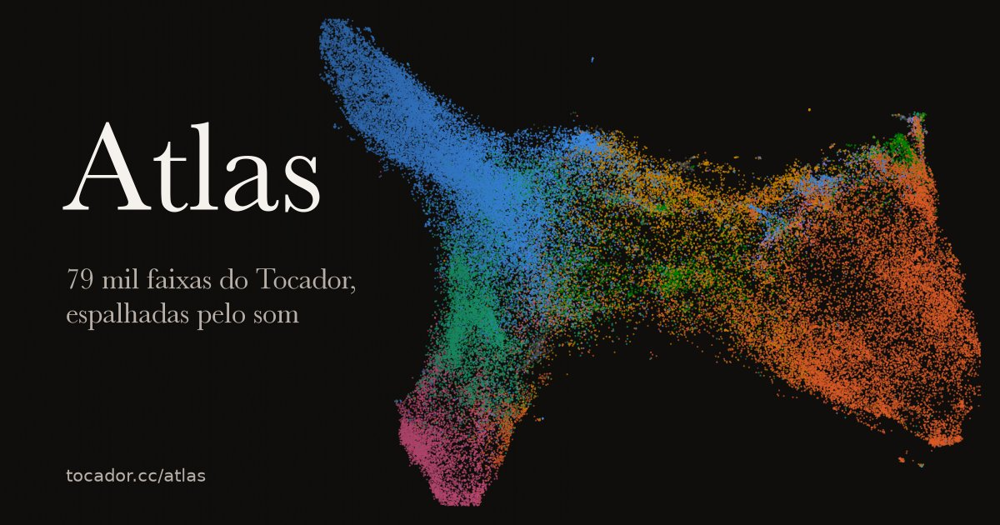

# Atlas

[tocador.cc/atlas](https://tocador.cc/atlas) mostra **todas as faixas** dos acervos UQT e Hominis
Canidae (~79 mil) como pontos num mapa. Faixas que soam parecido ficam perto. Dá para aproximar,
arrastar, girar em 3D (botão direito do mouse no desktop; no celular, ligue o ⟳ e arraste com um dedo) e clicar numa faixa para ouvir no player.

Para uma visita guiada, o botão **▶ Tour** (tecla `T`, ou [tocador.cc/atlas?tour=1](https://tocador.cc/atlas?tour=1))
faz em quase 2 minutos o caminho pelo mainstream, pelas raridades, pelas fusões, pelos mapas Som e Gêneros e pelo grafo,
com a sonificação tocando o que a câmera vê. O roteiro, cena a cena, está em [TOUR.md](TOUR.md).



## Como ler o mapa

- **Cada ponto é uma faixa.** A cor é o macro-gênero mais provável segundo o classificador (Rock,
  Latino, Eletrônica, Folk/World, Hip Hop, Jazz, Pop, Funk/Soul, Outros).
- **De onde vêm os gêneros.** Ninguém etiquetou estas faixas à mão. Quem ouve é o
  [Discogs-EffNet](https://essentia.upf.edu/models.html#discogs-effnet), um modelo do Essentia (MTG,
  Universitat Pompeu Fabra) treinado com milhões de faixas cujas etiquetas de estilo vieram do
  [Discogs](https://www.discogs.com/), a base colaborativa de discos. Por isso o vocabulário é o do
  Discogs: 400 estilos no formato `Gênero---Estilo` (`Latin---Samba`, `Rock---Punk`), e a cor do ponto é a
  parte antes do `---`. O mesmo modelo dá o embedding de 1280 dimensões que posiciona o mapa "Som". Ele
  herda os vieses do Discogs: o que lá é raro (samba de enredo, choro, gravações dos anos 1930) ele
  conhece pouco e tende a encaixar no estilo vizinho mais catalogado.
- **Os rótulos** (Samba, Punk, Cloud Rap…) ficam na mediana dos pontos de cada subgênero. Só aparecem
  os subgêneros que formam um "lugar", isto é, que não estão espalhados pelo mapa inteiro.
- **De perto**, a partir de ~10× de zoom, cada ponto ganha o título da faixa.
- **Os eixos não significam nada.** Não existe "mais para a direita = mais rápido". O [UMAP](https://umap-learn.readthedocs.io/) só preserva
  vizinhança: o que está perto é parecido, mas a distância entre regiões longe uma da outra não é uma
  medida confiável (Samba longe de Punk quer dizer "diferentes", não "x vezes mais diferentes").
- **Dois mapas** (botão Som / Gêneros):
  - **Som**: a posição vem do áudio. Mostra o que *soa* parecido, independente do rótulo.
  - **Gêneros**: a posição vem só dos rótulos de gênero previstos. Mostra o que o *classificador acha*
    parecido; os grupos são mais limpos, mas repetem os rótulos.

O que se vê no mapa "Som", de frente:
- **Rock**: ocupa o oeste, com Punk e Hardcore numa ponta e Indie e Alternative mais ao centro.
- **Latino**: ocupa o leste, num bloco denso de Samba, MPB, Batucada e Bossa Nova (quase todo o acervo UQT).
- **Folk e Jazz**: fazem a ponte entre os dois. Neofolk encosta no Rock, Bossa Nova encosta no Jazz.
- **Hip Hop**: forma uma península ao sul (Cloud Rap, Trap, Gangsta), ligada à Eletrônica.
- **Eletrônica**: dividida em duas regiões: Experimental/Ambient ao norte, House/Downtempo/Synth-pop ao sudoeste.

## Música generativa

Navegar pelo mapa toca uma música gerada na hora, a partir do que a câmera está vendo. Nenhum arquivo de áudio é
tocado: tudo é sintetizado no navegador com Web Audio. O botão ♪ (tecla `M`) liga e desliga, e o navegador só deixa
soar depois do primeiro clique ou tecla.

### Como funciona

- **Os pontos são a partitura.** A cada ~200 ms, `regiaoSom()` (`js/atlas.js`) lê o que está à vista como um piano roll
  de 4 linhas por 16 colunas em volta do centro da tela. Quantos pontos caem em cada célula decide onde há nota, a altura
  deles na tela dá o contorno, e a identidade das faixas dá o detalhe. Filtrar, arrastar ou dar zoom reescreve as notas
  seguintes a cada tempo, sem esperar a frase acabar. Mexer pouco muda pouco, e tela vazia não tem melodia. Com o mapa
  parado, a frase se repete.
- **Muitos gêneros, uma banda.** Até 6 das 57 famílias de `js/atlas-receitas.js` soam ao mesmo tempo, com ganho de igual
  potência, para uma zona mista soar tão cheia quanto uma pura. Em vez de empilhar bandas, `fundir()` junta os gêneros:
  um andamento ponderado entre os deles, um só balanço (a média dos grooves), harmonia emprestada de cada um conforme o
  peso, sobre o mesmo tom, e baixo e levada que trocam de mãos. Na bateria, cada papel (chão, tronco, condução) tem um
  dono, e os outros só preenchem os espaços dele. Só há uma melodia: cada nota vem de um gênero, conforme o peso, e todos
  a cantam no próprio instrumento, então o timbre atravessa junto com o mapa.
- **Grafo.** Vale o mesmo: os artistas à vista, na visão geral ou em volta de um centro, são a mistura e a partitura.
  Andar de vizinho em vizinho reescreve a música; o zoom da visão geral abre as camadas.
- **Zoom.** De longe se ouve só a cama, abafada. Aproximando entram baixo e ritmo, depois acordes, depois melodia. O
  filtro da câmera abre até por volta de 6×, e a percussão abre uma oitava antes do resto. Mover ou aproximar o mapa
  não faz som próprio (sem vento, sem notas na mira): só muda o que está à vista, e portanto a mistura e as camadas.
- **Dados das faixas.** As features da região ajustam o andamento (até ±30% do da família), a densidade do ritmo, o
  brilho e o tom.
- **Receita.** Cada família é só dado: padrões de percussão, célula de baixo, levada, harmonia, escala e timbres.
- **Execução (`js/atlas-som.js`).** O motor toca a receita como uma banda:
  - **Groove:** cada gênero tem seu microtiming (a célula do samba antecipa as semicolcheias finais do tempo) e cada
    instrumento seu atraso habitual. Máquinas (house, techno) ficam na grade.
  - **Forma:** frases de 8 compassos em A A B A, virada a cada 4 compassos, prato na entrada e parada a cada 16.
  - **Harmonia:** cada acorde usa a inversão que menos se move a partir do anterior, sem a fundamental quando o baixo
    já a toca, e o baixo chega ao próximo acorde por semitom.
  - **Melodia:** frases de 4 compassos lidas dos pontos, por graus da escala, que fecham numa nota do acorde e deixam
    espaço para respirar.
  - **Timbre:** cordas dedilhadas são Karplus-Strong, pré-calculado em `AudioBuffer` ao primeiro uso; pratos usam as
    seis ondas quadradas da 808. Há transiente de ataque, sopro, e nenhuma nota sai idêntica à anterior.
  - **Mixagem:** cada instrumento tem seu lugar no estéreo, a percussão vai mais seca, há sala curta e longa, eco de
    fita (dub, reggae) e o bumbo empurra o resto (house, techno).

### Como foi criada

A ideia veio do mapa [Cantography](https://github.com/rafapolo/cantography/blob/main/design/sound.md), que faz o mesmo com dados de empresas:
de lá vêm as três famílias de som (dados, interface, momentos), a cama (o vento de lá foi tirado depois), o filtro aberto pelo zoom e as notas
determinísticas por `hash()`, em que o mesmo lugar sempre soa igual. Depois vieram as receitas por gênero, escritas à
mão, e o relógio único. As decisões estão em `tasks/generative-music-nav.md` (só local).

A segunda rodada usou uma medida objetiva, porque áudio é difícil de julgar lendo código: o mesmo modelo que pôs as
faixas no mapa escuta a música sintetizada.

```bash
node script/render-som-atlas.js /tmp/som                       # ~7 min: 57 famílias, 2 tomadas de 30 s em WAV
python3 script/avaliar-som-atlas.py /tmp/som --antes antes.json   # precisa do Essentia e dos modelos
```

A nota principal é o cosseno entre o embedding do render e o centroide das faixas reais da família, no zoom máximo.
Medindo cada mudança isolada, o resultado desmentiu boa parte das suposições:

| Mudança | O que a medida disse |
|---|---|
| Cama de pad alta com a banda tocando | Quase tudo soava como `Electronic---Ambient`; ela agora recua ao entrar a banda |
| Baixo por Karplus-Strong | Piorou, com o rótulo `Chiptune`; o brilho precisa contar harmônicos, e mesmo corrigido o baixo voltou a ser osciladores |
| Melodia em primeiro plano | Foi o que mais pesou: sem ela a nota subia, então ela ficou mais baixa e mais esparsa |
| Microtiming, forma, estéreo | Quase não mudam a nota, porque o modelo olha para o espectro; ficaram por serem o que faz música soar tocada |
| Coloração de gravação antiga | Ajudou em samba, salsa e jazz, e atrapalhou em MPB e folk; depois deu lugar à equalização medida por família |

Com isso, a nota média foi de 0,166 para 0,187, e 35 das 57 famílias subiram.

A terceira rodada trocou palpite por dado. `script/amostrar-som-real.js` e `script/perfil-som-real.py` medem 888 trechos de
faixas reais, 16 por família: espectro, andamento e microtiming. A ginga do samba medida ficou muito perto da estimada à
mão, e o forró real anda a 104 BPM, não a 124. `script/ajustar-som-atlas.py` usa esses perfis para equalizar cada família
e busca, uma a uma, níveis, sala e timbre da melodia, gravando o resultado no bloco `AJUSTES` de `js/atlas-receitas.js`.
Ele ajusta numa tomada e valida em outra: numa tomada que a busca nunca ouviu, a nota foi de 0,176 para 0,273.

Resultado final, com o motor atual e o volume das famílias igualado: a nota média foi de **0,166 para 0,265**, e 46 das 57
famílias subiram. O gênero certo entre os 5 primeiros do modelo foi de 9 para 19 famílias. Nuvem, trap, reggaeton e boom bap
foram as que mais ganharam. Balada foi a que mais perdeu, e forró, samba, tango, ska e MPB seguem com nota negativa.

Por fim, a viagem: navegar de verdade pelo mapa inteiro, de samba a rock e ao grafo, gravando o estado do motor. Foi assim
que apareceram o volume caindo nas zonas mistas e o modo piscando com o mapa parado.

### Limitações da música

- **A nota mede se o som parece o gênero para esse modelo, não se é bonito.** Ela é uma aproximação e nunca substitui
  o ouvido.
- **Forró, samba e MPB seguem entre as piores**, embora sejam o coração dos acervos. A busca escolheu voz ou coro em
  16 famílias, mas é um canto sintetizado, sem letra, e não sei se isso explica a distância para as faixas reais.
- **Quem está longe ouve outra música.** A nota foi medida no zoom máximo; de longe só há cama.
- **A fusão não foi avaliada pela nota.** Ela mede uma família por vez; misturas foram conferidas navegando, não de ouvido.

## Como foi feito

```
MP3 dos acervos (S3)
  └─ analyze-tracks.py (Essentia + TensorFlow, trecho central de 45 s por faixa)
       ├─ embedding EffNet-Discogs, 1280 dimensões ── "som"
       ├─ top-5 gêneros Discogs-400 (+ BPM, tom, humor, instrumentos…)
       └─ data/features/<acervo>.json.gz + .emb.f16
  └─ script/build-atlas-coords.py
       ├─ som:     normalização L2 → PCA 64 → UMAP cosseno (30 vizinhos, min_dist 0,08)
       ├─ rotulos: scores dos 5 gêneros, matriz esparsa L2 → SVD 50 → UMAP cosseno
       └─ cada um em 2D e depois em 3D, partindo do 2D (init = x, y do 2D + z ~ 0)
          → data/features/atlas-coords.json.gz
  └─ script/build-atlas-web.js
       ├─ casa cada faixa analisada com o catálogo publicado (aliases incluídos)
       ├─ quantiza x, y, z em Uint16 (mesma escala nos três eixos)
       ├─ guarda um hash de 32 bits da chave "<álbum>/<arquivo>" por ponto
       └─ calcula os rótulos (mediana de cada subgênero) → data/atlas-faixas.json.gz (~1,4 MB)
  └─ atlas.html + js/atlas.js (WebGL)
```

Decisões que importam:

- **O 3D parte do 2D.** O UMAP 3D recebe as posições do 2D como ponto de partida, então visto de frente
  o mapa continua reconhecível, e girar acrescenta profundidade em vez de embaralhar tudo.
- **Pontos casados por hash, não por ordem.** A página baixa o catálogo e procura cada faixa pelo hash
  da chave. Um ETL que acrescente ou reordene álbuns (a conversão v2 ordena por artista) não quebra o
  mapa: faixas novas ficam sem ponto até a próxima geração.
- **Desenho.**
  - Todos os pontos vão numa única chamada `gl.POINTS`, com a cor por gênero e o filtro (busca, gênero,
    acervo) num atributo.
  - A troca Som ↔ Gêneros é um `mix()` no shader entre as duas posições.
  - No 3D, a rotação é ortográfica em torno do ponto no centro da tela, com tamanho e brilho como pista
    de profundidade.
- **Clique.** Na vista plana, uma grade 256×256 acha o ponto mais perto. Girado, projeta todos os
  pontos (~1 ms).
- **Ir para o player.** O link reproduz a numeração de faixas do player (deduplicação por título,
  `num ?? posição`) e abre a página do álbum no tocador.cc (`/<acervo>/<slug>/?play=1#tN`).

## Limitações

- **75 faixas do UQT não têm ponto.** 74 são MP3 de 0 byte já no backup de origem, e uma tem ~1 s
  (`tasks/uqt-faixas-vazias.md`, só local).
- **O UMAP não é incremental.** Rodar de novo após um ETL redesenha o mapa inteiro, e as regiões podem
  mudar de lugar.
- **Gênero é previsão de modelo, não metadado.** Ele erra de forma sistemática, como no caso das
  gravações antigas.
- **O mapa reflete um trecho de 45 s** do meio de cada faixa, não a faixa inteira.

## Regenerar (depois de um ETL)

```bash
uv run -q --with umap-learn --with scikit-learn --with scipy --with numpy \
  python script/build-atlas-coords.py          # ~25 min sem --reuse-* (2D + 3D dos dois mapas)
bun script/build-atlas-web.js                  # payload + relatório de cobertura
uv run -q --with matplotlib --with numpy --with pillow python script/build-atlas-og.py
```

Testes: `npx playwright test tests/atlas.spec.js` (fixtures em `tests/fixtures/build-atlas-fixture.js`).
