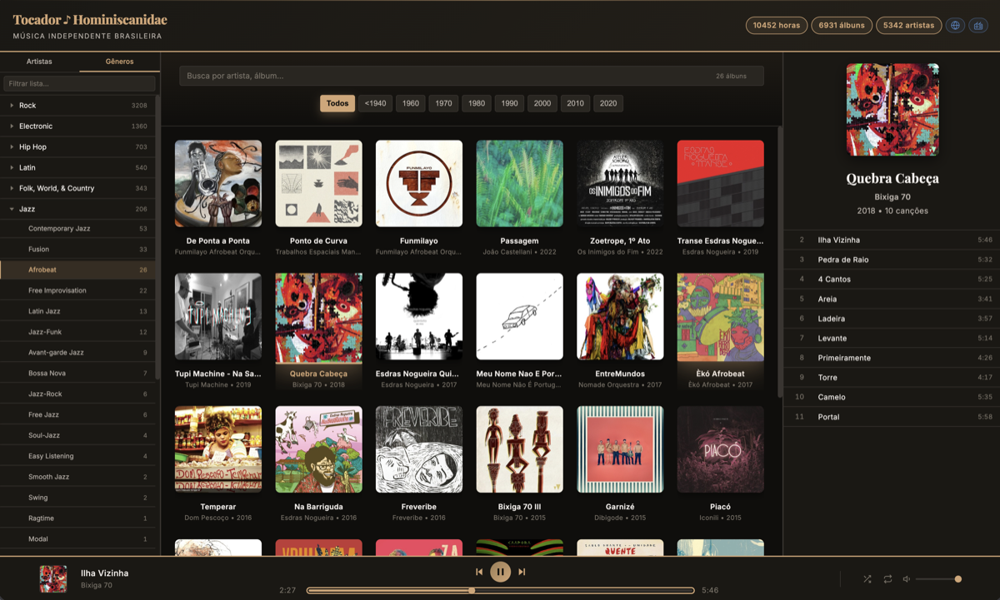
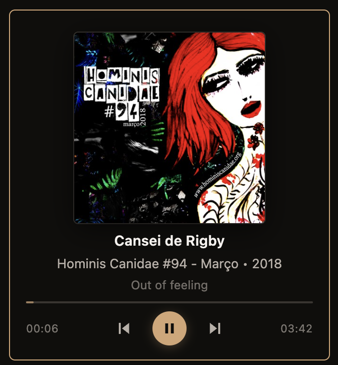
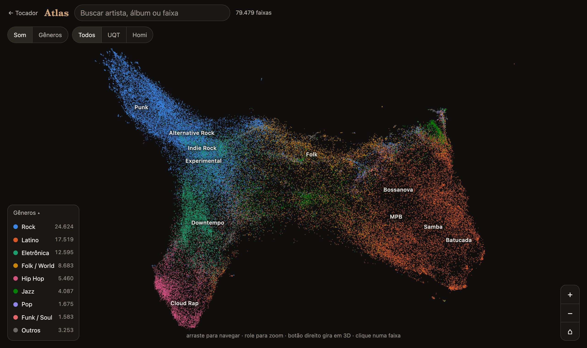
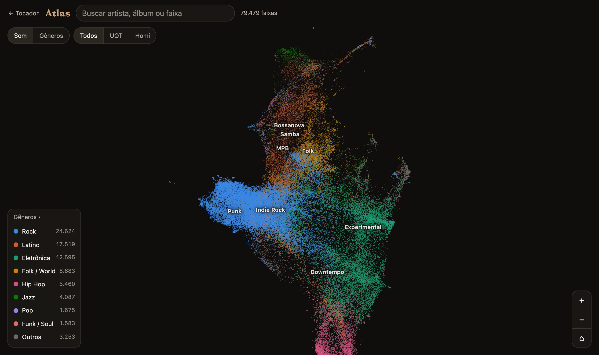
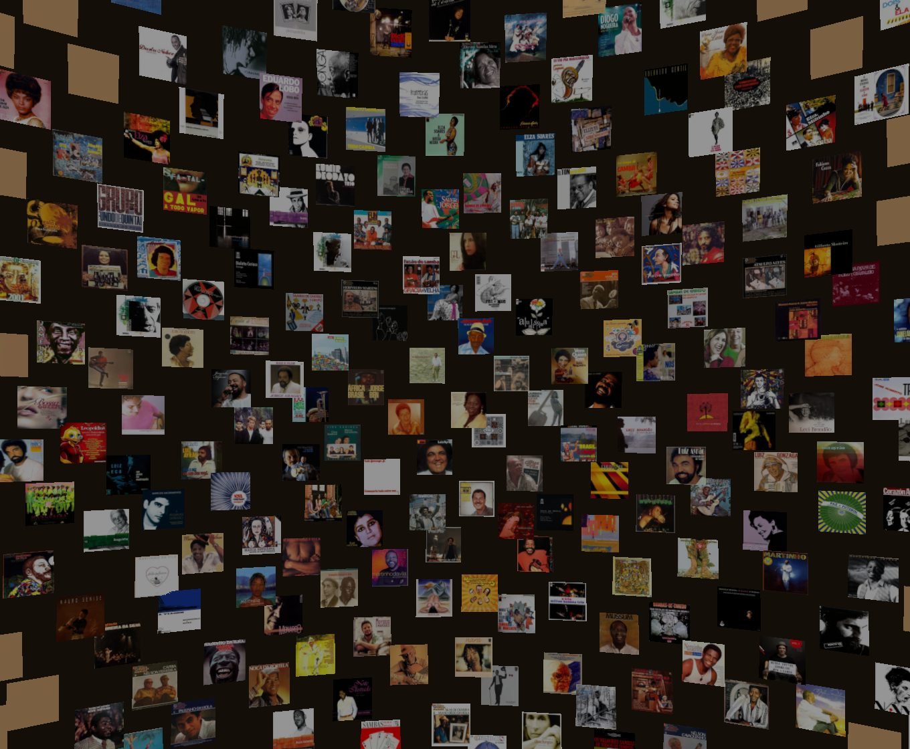

# Tocador

Um player web para acervos musicais. Aponte para qualquer `.json.gz` compatível e toque: sem build, sem framework, funciona em qualquer CDN estática.

> **Tocador é uma plataforma**: o mesmo player toca muitos acervos. Cada acervo é um catálogo independente, escolhido por `?acervo=`.

<p align="center">
  <a href="https://tocador.cc/">
    
  </a>
</p>

<p align="center">
  <a href="https://radio.tocador.cc"></a>
  
  
  
</p>

## ✨ O player

- **Grade de álbuns** com rolagem virtual (~30 cards no DOM, qualquer que seja o tamanho do acervo) e ▶ sobre cada capa.
- **Busca** por artista, álbum ou faixa, e **seletor de década** ao lado, com a contagem de álbuns de cada uma.
- **Painel Navegar** (`B`): árvore de gêneros (`G`), artistas e salvos.
- **Pegada** (`E`): filtra por características do áudio (andamento, dançabilidade, humor, acústico/eletrônico, voz) com controles sobre o histograma do acervo. A filtragem é por faixa: as que não passam aparecem desativadas no álbum.
- **Salvos e playlists**: o coração guarda álbuns; a aba Salvos toca todos em sequência ou embaralhados e gera um link `share-playlist` para compartilhar.
- **Links**: cada álbum tem página própria em `/<acervo>/<slug>/`, com prévia de link com capa; a faixa vai como `#tN`, e depois de 5 s o link aponta para o segundo exato. Artistas têm `/<acervo>/artista/<slug>/`.
- **Reprodução**: a próxima faixa entra sozinha, o aleatório sorteia entre os álbuns filtrados (e serve de "me surpreenda"), há repetir faixa/álbum e a posição fica salva por acervo, com oferta de continuar de onde parou. Faixa indisponível é pulada; erro de rede oferece "Tentar de novo".
- **Soa parecido com**: vizinhos sonoros dos artistas do álbum, vindos do Atlas.
- **PWA** instalável; uma aba tocando pausa as outras do tocador.
- **Erros viram issues**: falhas de catálogo, dados e reprodução são reportadas como issues no GitHub.

**Atalhos:** `Espaço` play/pausa · `←/→` ±10 s · `N` próxima · `P` anterior · `/` busca · `B` navegar · `E` Pegada · `G` gêneros · `?` lista de atalhos.

### ♿ Acessibilidade

Tudo alcançável por teclado; `aria-label` nos botões de ícone, `aria-pressed` em aleatório e repetir, barra de progresso como `role="slider"`, troca de faixa anunciada em `aria-live`, foco visível. Os controles da Pegada têm `aria-valuetext` e anunciam a contagem de resultados.

<sub>Auditado com [`chrome-devtools-mcp`](https://www.npmjs.com/package/chrome-devtools-mcp) + Lighthouse. O ponto restante de acessibilidade (`user-scalable=no`) é intencional.</sub>

## 📻 Rádio

[`radio.tocador.cc`](https://radio.tocador.cc) é um widget mínimo que toca faixas aleatórias de um acervo:

```
https://tocador.cc/radio?acervo=homi
https://tocador.cc/radio?acervo=uqt
```

<p align="center">
  <a href="https://radio.tocador.cc">
    
  </a>
</p>

Para incorporar:

```html
<iframe src="https://tocador.cc/radio" width="328" height="355" frameborder="0"></iframe>
```

Avança sozinho (também em caso de erro), volta à faixa anterior, mostra capa, artista, álbum e ano, e leva ao player com um clique.

## 🗺️ Atlas

[`tocador.cc/atlas`](https://tocador.cc/atlas) põe as ~79 mil faixas dos dois acervos num mapa: cada ponto é uma faixa, e o que soa parecido fica perto (UMAP do embedding de áudio). Aproxime para ver os nomes, gire em 3D, filtre por gênero ou acervo, busque um artista, abra o grafo de artistas parecidos (`G`) e clique numa faixa para ouvir. O botão **Sonificar** gera música na hora a partir dos gêneros que estão na tela, e o **Tour** ([`/atlas/tour`](https://tocador.cc/atlas/tour)) atravessa o mapa em 105 segundos. Como foi feito e como ler o mapa: [ATLAS.md](ATLAS.md).

<p align="center">
  <a href="https://tocador.cc/atlas"></a>
  <a href="https://tocador.cc/atlas"></a>
</p>

## 🌌 Universo 3D

[`tocador.cc/3d`](https://tocador.cc/3d) mostra os álbuns de um acervo como uma galáxia de capas: arraste para girar, role para avançar e clique numa capa para abrir o álbum.

<p align="center">
  <a href="https://tocador.cc/3d"></a>
</p>

## 📦 Acervos

```
https://tocador.cc/?acervo=<alias_ou_url>
```

| alias | acervo |
|---|---|
| `uqt` | Acervo UQT: samba, MPB, bossa nova |
| `homi` | Hominis Canidae: música independente |

Qualquer URL pública para um `.json.gz` no formato abaixo também funciona (`?acervo=https://exemplo.com/meu-acervo.json.gz`). O acervo escolhido persiste na sessão.

## 🗂️ Formato do acervo

```json
{
  "meta": {
    "title": "Meu Acervo",
    "subtitle": "Subtítulo",
    "hours": "42",
    "base_url": "https://cdn.exemplo.com/musicas"
  },
  "albums": [
    {
      "title": "Nome do Álbum",
      "artist": "Artista",
      "year": 1975,
      "path": "1975 - Artista - Nome do Álbum",
      "has_cover": true,
      "tracks": [
        { "title": "Nome da Faixa", "num": 1, "file": "01 Nome da Faixa.mp3", "artists": "Artista", "duration": 214 }
      ]
    }
  ]
}
```

`base_url + "/" + path + "/" + file` → áudio · `base_url + "/" + path + "/capa-min.jpg"` → capa.

Há também um formato colunar (v2, ~37% menos para o navegador interpretar); o player lê os dois. Detalhes no [CLAUDE.md](CLAUDE.md).

## 🛠️ Criar um acervo

Guia completo em [`script/README.md`](script/README.md). Em resumo:

```bash
# 1. catálogo a partir dos MP3 (versão em Rust, a preferida para acervos grandes)
cd script/generate-albums && cargo build --release && cd -
./script/generate-albums/target/release/generate-albums /caminho/das/musicas acervo.json.gz

# 2. áudio para o bucket S3
ARCHIVE_DIR=/caminho/das/musicas bun script/sync-to-bucket.js

# 3. capas de 200 px
ARCHIVE_DIR=/caminho/das/musicas bun script/resize-cover-images.js --acervo <alias>
```

### Acrescentar álbuns sem o volume de música

O áudio publicado vive só no S3. Álbuns novos ficam numa pasta de staging, sobem para o bucket e entram no catálogo publicado por merge:

```bash
./script/generate-albums/target/release/generate-albums ~/staging/unzips novos.json.gz \
  --title "…" --subtitle "…" --base-url https://cdn.exemplo.com/acervo --s3-prefix acervo/

bun script/merge-acervo.js publicado.json.gz novos.json.gz --dry-run
S3_PREFIX=acervo/ ARCHIVE_DIR=~/staging/unzips node script/sync-to-bucket.js --dry-run
S3_PREFIX=acervo/ ARCHIVE_DIR=~/staging/unzips node script/sync-to-bucket.js
bun script/merge-acervo.js publicado.json.gz novos.json.gz
```

O merge recusa duplicatas (caminho, artista/título/ano ou artista + faixas), mantém o formato (v1 ou v2) e só grava se todos os álbuns antigos voltarem idênticos e com o mesmo slug.

## ⚙️ Arquitetura

- **Player** (`index.html` + `js/`): JavaScript puro, scripts clássicos sem build, servido pelo GitHub Pages. O catálogo chega gzipado e é aberto com `DecompressionStream` (com um fallback de ~5 KB para navegadores antigos).
- **Páginas por álbum e sitemaps**: geradas no deploy por `script/build-album-pages.js` a partir dos catálogos publicados.
- **Dados de áudio**: `script/analyze-tracks.py` (Essentia) extrai andamento, tom, humor, gênero e um embedding por faixa; daí saem a Pegada, os gêneros e o Atlas.
- **Proxy** (`proxy.js` + `lib/`): Bun com `Bun.S3Client`, atrás de nginx, em `cdn.tocador.cc`. Os buckets são privados: todo áudio e capa passa pelo proxy, que assina a requisição, repassa `Range` (seek sem baixar o arquivo), aplica limites por aparelho e IP e recusa hotlink. O nginx guarda as capas em cache.
- **Deploy**: o player vai para o GitHub Pages a cada push; o proxy, por Haloy + Docker, com um teste real de áudio antes de dar o deploy por bom e um monitor a cada 30 min.

Detalhes, armadilhas e solução de problemas: [CLAUDE.md](CLAUDE.md) e [docs/PROXY_SETUP.md](docs/PROXY_SETUP.md).

## 🤝 Contribuições

Abra uma [issue](https://github.com/rafapolo/tocador/issues) ou um [pull request](https://github.com/rafapolo/tocador/pulls).

---

**Feito para tocar** ♪ · [tocador.cc →](https://tocador.cc/)
